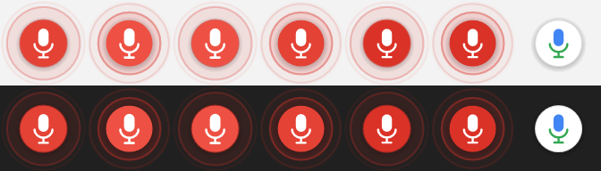

# HebrewDictate — הקלדה קולית בעברית ל-Windows

הקלדה קולית בעברית לכל שדה טקסט ב-Windows, בדומה ל-`Win+H`. ההקלדה הקולית המובנית של Windows לא תומכת בעברית, והתוכנה הזו ממלאת את החסר.

לוחצים על קיצור מקשים (או על כפתור מיקרופון צף קטן), מדברים בעברית, והטקסט נכתב לחלון שנמצא בפוקוס, בזמן אמת, תוך כדי הדיבור.

[English ← README.md](README.md)



## מה היא עושה

- מקלידה דיבור בעברית ל**כל** תוכנה (דפדפן, Word, צ'אט, עורכי טקסט), ולא רק לאתר אחד.
- **הקלדה חיה**: המילים מופיעות תוך כדי דיבור ומתוקנות כשהמנוע משפר את הניחוש.
- קיצור מקשים גלובלי **Ctrl+Alt+D** (אם תפוס, Ctrl+Alt+H ואז Ctrl+Shift+H), או **כפתור מיקרופון צף** שאפשר לגרור, תמיד מעל החלונות, ושלא גונב פוקוס כשלוחצים עליו.
- **פיסוק בקול**: "נקודה" `.`, "פסיק" `,`, "נקודתיים" `:`, "סימן שאלה" `?`, "סימן קריאה" `!`, "שורה חדשה" או "ירידת שורה" (Enter), "פסקה חדשה" (שני Enter). אפשר לכבות עם `VoiceCommands = false` בקוד.
- יושבת במגש המערכת: הפעלה ועצירה, הצגה והסתרה של חלון הזיהוי ושל הכפתור הצף, הפעלה עם Windows ויציאה.
- בלי חשבון, בלי מפתח API, ובלי מגבלת שימוש מצד התוכנה.

## איך זה עובד

זיהוי הדיבור נעשה על ידי **ממשק הדיבור המובנה של Chrome** (`webkitSpeechRecognition`, המנוע של גוגל, שפה `he-IL`). HebrewDictate היא תוכנת Windows קטנה שמארחת אותו ומקלידה את התוצאה:

```
 מיקרופון ─► חלון Chrome מוסתר ──► שירות הדיבור של גוגל
                │  הדף מריץ SpeechRecognition (he-IL, רציף, תוצאות ביניים)
                │  HTTP על 127.0.0.1:48731 (מפתח אקראי בכל הפעלה)
                ▼
         HebrewDictate.exe  (C#, WinForms, סמל במגש)
           - RegisterHotKey לקיצור המקשים הגלובלי
           - long-poll אומר לדף מתי להתחיל ולעצור
           - מקבלת טקסט ביניים וסופי והופכת פקודות קוליות לפיסוק
           - SendInput (Unicode) מקלידה לחלון הפעיל, ומוחקת ומקלידה מחדש
             רק את החלק ששונה
```

דברים חשובים:

- Chrome רץ עם **פרופיל משלו** (`%LOCALAPPDATA%\HebrewDictate\profile`), נפרד מהגלישה הרגילה, והחלון שלו **מוסתר** (לא ממוזער), כך שהוא לא מופיע בשורת המשימות. הוא מוצג רק כשצריך תשומת לב, למשל באישור המיקרופון הראשון.
- השרת המקומי מקבל רק בקשות עם `Host` נכון ועם מפתח אקראי שנוצר בכל הפעלה ומועבר לדף, כך שאתרים אחרים לא יכולים לגרום לו להקליד לחלונות שלכם.
- טקסט ביניים נכתב כשהוא מגיע. אם עוברים לחלון אחר באמצע משפט, הטקסט הישן נשאר כמו שהוא והמשפט ממשיך בחלון החדש.

## דרישות

- Windows 10/11 (עם .NET Framework 4.x שמגיע עם Windows)
- Google Chrome
- חיבור לאינטרנט (הזיהוי נעשה אצל גוגל)
- מיקרופון

## התקנה ושימוש

1. מורידים את `HebrewDictate-win.zip` מעמוד ה-[Releases](../../releases) ופורסים לתיקייה קבועה (למשל `%LOCALAPPDATA%\HebrewDictate`).
2. מפעילים את `HebrewDictate.exe`. מופיע סמל מיקרופון במגש וכפתור מיקרופון צף על המסך.
3. בפעם הראשונה חלון קטן מבקש גישה למיקרופון. לוחצים **אפשר**, והחלון מסתתר מעצמו.
4. לוחצים בשדה טקסט, ואז **Ctrl+Alt+D** או על הכפתור הצף. מדברים. לוחצים שוב כדי לעצור.
5. לחיצה ימנית על הסמל במגש או על הכפתור פותחת תפריט, כולל **הפעל עם Windows**.

הקובץ לא חתום, ולכן SmartScreen של Windows עלול להזהיר בהפעלה הראשונה ("מידע נוסף" ← "הפעל בכל זאת"). אפשר לאמת את ההורדה מול `SHA256.txt` שב-Release, או לבנות בעצמכם.

## בנייה מהקוד

לא צריך SDK. ב-Windows יש מהדר C# מובנה:

```bat
build.bat
```

הפקודה יוצרת את `bin\HebrewDictate.exe` מהקובץ `src\Dictate.cs` (קובץ יחיד). דחיפת תגית כמו `v1.0.0` (או הפעלה ידנית) מריצה את `.github/workflows/build.yml`, שבונה ב-GitHub ומעלה את ה-zip כ-artifact של ה-workflow.

## פרטיות

האודיו עובר מ-Chrome לשירות הדיבור של גוגל, בדיוק כמו בחיפוש קולי ב-Chrome. HebrewDictate עצמה לא שולחת דבר החוצה: היא מדברת רק עם Chrome דרך `127.0.0.1`. היא שומרת קובץ הגדרות קטן (מיקום הכפתור הצף) ואת הפרופיל של Chrome תחת `%LOCALAPPDATA%\HebrewDictate`. אל תכתיבו מה שלא הייתם אומרים לגוגל.

## מגבלות

- דורשת Chrome ואינטרנט, ואין מצב לא מקוון.
- לא מקלידה לחלונות שרצים כמנהל מערכת (Windows חוסם), ויש תוכנות (משחקים, שדות מאובטחים) שמתעלמות מקלט מלאכותי.
- התיקון החי עובד במחיקה ובהקלדה מחדש. בעורכים עם השלמה או תיקון אוטומטי אגרסיביים ההתנהגות עלולה להיות מוזרה. אם כך, דווחו על התוכנה.
- המנוע לא מוסיף פיסוק בעברית אוטומטית. משתמשים בפקודות הקוליות.
- הדיוק והמהירות הם של מודל העברית של Chrome.
- נבדקה בעיקר ב-Windows 11, והלוגיקה נבדקה בנפרד. בדיקות נוספות יתקבלו בברכה.

## פתרון בעיות

- **לא נכתב כלום**: ודאו שהסמל במגש אדום (מקשיבה) ושיש ל-Chrome הרשאת מיקרופון (תפריט המגש ← *הצג / הסתר חלון זיהוי*).
- **הקיצור לא עובד**: ייתכן שתוכנה אחרת תפסה אותו. התוכנה בוחרת את הראשון הפנוי מבין Ctrl+Alt+D, Ctrl+Alt+H, Ctrl+Shift+H ומציגה אותו בהסבר הקצר של סמל המגש.
- **Chrome לא נמצא**: התקינו Google Chrome (התוכנה מחפשת ב-Program Files הרגיל ובמיקום הפרטי של המשתמש).
- **הפורט תפוס**: התוכנה צריכה את `127.0.0.1:48731`. שנו את `Port` בקוד ובנו מחדש.

## רישיון

MIT, ראו [LICENSE](LICENSE).
